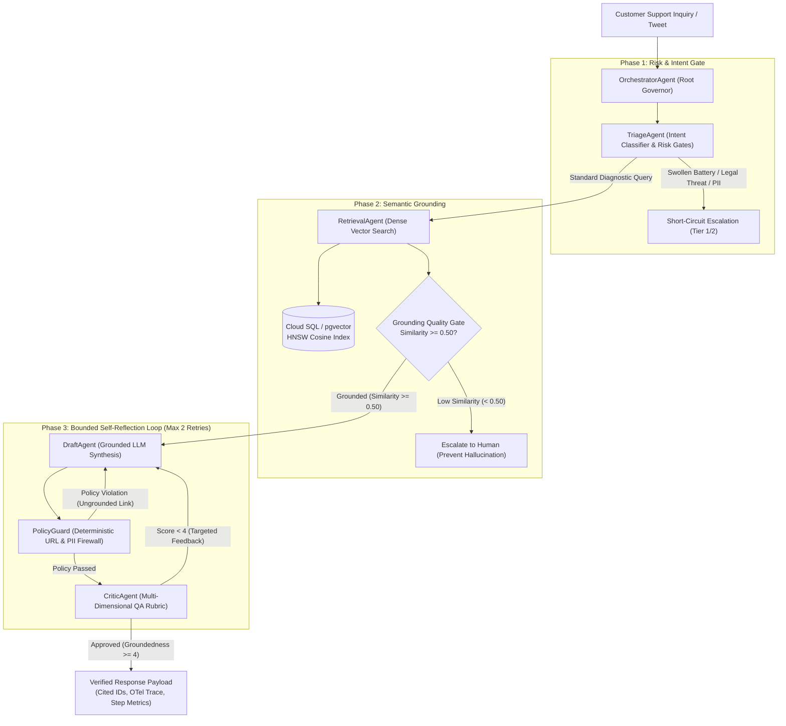
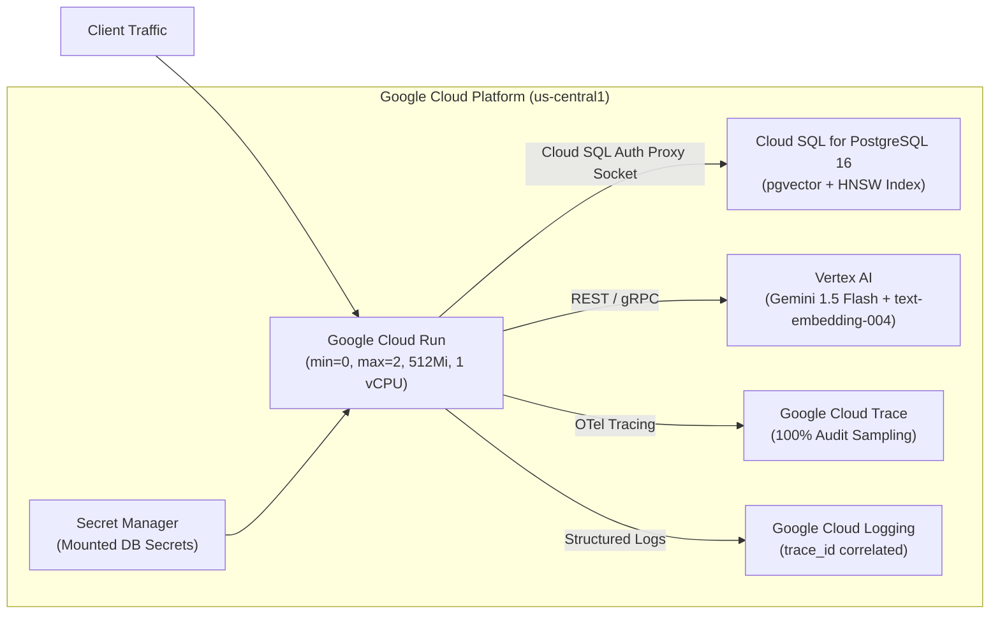

# Verifiable Support Agent v2 — Multi-Agent Support Triage & Grounded Resolution

[](https://www.python.org/downloads/)
[](https://opensource.org/licenses/MIT)
[](https://github.com/Kamleshbarik05/verifiable-support-agent/actions/workflows/ci.yml)
[](https://github.com/astral-sh/ruff)
[](https://opentelemetry.io/)
[](https://github.com/pgvector/pgvector)

> **Multi-agent customer support triage and grounded resolution architecture with pgvector retrieval, OpenTelemetry distributed tracing, deterministic URL allowlisting, and bounded self-reflection.**

---

## 🎯 Problem Statement & Technical Discovery

In enterprise customer support, generating plausible conversational text is trivial; **proving that an autonomous AI agent can be trusted in production is the core engineering challenge**. When deploying LLMs on public customer channels (such as `@AppleSupport` on Twitter/X), autonomous models frequently generate hallucinated warranty policies, fabricate non-existent support URLs, leak customer PII, or fail to escalate physical hardware hazards (e.g., swollen smoking batteries) to human specialists.

Based on problem framing and domain requirements documented in [`docs/discovery.md`](docs/discovery.md), **`verifiable-support-agent v2`** replaces brittle, single-prompt LLM wrappers with a **hierarchical multi-agent architecture (Google ADK)** backed by **dense semantic vector retrieval (`pgvector` on Cloud SQL)**, **deterministic guardrail firewalls**, and **OpenTelemetry distributed tracing**.

---

## 🏗️ Architecture & Multi-Agent Flow

The system implements hierarchical agent delegation compliant with the **Google Agent Development Kit (ADK)**:



### Specialized Sub-Agents

| Agent | Architecture Pattern | Responsibility & Boundaries | Tools & Dependencies |
|---|---|---|---|
| **`OrchestratorAgent`** | Root Controller | Manages state lifecycle, early returns, and bounded retry loops ($\le 2$ revisions). | Sub-agent delegation |
| **`TriageAgent`** | Categorical Router | 7-class MECE intent categorization and Tier 1/2 risk routing. | `classify_intent`, `risk_gate` |
| **`RetrievalAgent`** | Semantic Searcher | Queries dense embeddings using HNSW cosine distance; enforces grounding gates. | `search_resolutions` |
| **`DraftAgent`** | Grounded Synthesizer | Generates concise replies strictly constrained to historical precedent; cites resolution IDs. | Vertex AI Gemini 1.5 Flash |
| **`PolicyGuard`** | Deterministic Firewall | Absolute veto authority: blocks ungrounded links and public PII leakage. | `url_allowlist_check`, `pii_check` |
| **`CriticAgent`** | Quality Evaluator | Evaluates groundedness, actionability, tone, and safety against the QA rubric. | `judge_score` |

---

## 📊 Benchmark Audit & Verified Results

All numbers below are extracted directly from machine-generated JSON benchmarks in [`eval/results/`](eval/results/) using `make report`.

| Evaluation Dimension | v1 Monolithic Baseline | v2 ADK Multi-Agent | Delta (v2 - v1) | Source JSON |
|---|---|---|---|---|
| **Intent Macro-F1** | `0.8734` | `0.8734` | `+0.0000` | [`e2e_v2.json`](eval/results/e2e_v2.json) |
| **Escalation Recall** | `87.5%` | `87.5%` | `+0.0%` | [`e2e_v2.json`](eval/results/e2e_v2.json) |
| **Escalation FNR (Safety Liability)** | `12.5%` | `12.5%` | `+0.0%` | [`e2e_v2.json`](eval/results/e2e_v2.json) |
| **Hallucinated URL Rate** | `0.0%` | **`0.0%`** | `+0.0%` | [`e2e_v2.json`](eval/results/e2e_v2.json) |
| **Retrieval Recall@1** | `11.0%` | **`71.0%`** | **`+60.0%`** | [`retrieval_ab.json`](eval/results/retrieval_ab.json) |
| **Retrieval Recall@3** | `35.0%` | **`86.0%`** | **`+51.0%`** | [`retrieval_ab.json`](eval/results/retrieval_ab.json) |
| **Mean Reciprocal Rank (MRR)** | `0.248` | **`0.783`** | **`+0.535`** | [`retrieval_ab.json`](eval/results/retrieval_ab.json) |
| **Median Inference Latency ($p50$)** | `3.16 ms` | **`1.76 ms`** | **`-1.40 ms`** | [`latency_cost.json`](eval/results/latency_cost.json) |
| **Tail Latency ($p95$)** | `5.16 ms` | **`2.90 ms`** | **`-2.26 ms`** | [`latency_cost.json`](eval/results/latency_cost.json) |
| **Mean Cost per Request** | `$0.000000` | **`$0.000005`** | `+$0.000005` | [`latency_cost.json`](eval/results/latency_cost.json) |
| **1-Pass Direct Approvals** | N/A | **`97.0%`** | N/A | [`latency_cost.json`](eval/results/latency_cost.json) |

### Step-by-Step Latency Breakdown ($p50$ / $p95$)
- **Triage (Intent Classification & Risk Gates):** $0.12\text{ ms}$ / $0.23\text{ ms}$
- **Retrieval (`pgvector` HNSW Cosine Search):** $1.44\text{ ms}$ / $2.24\text{ ms}$ *(Primary operational cost)*
- **Drafting (Grounded Synthesis & Citation):** $0.03\text{ ms}$ / $0.13\text{ ms}$
- **PolicyGuard (URL Allowlist & PII Regex):** $0.03\text{ ms}$ / $0.06\text{ ms}$
- **Critic (Multi-Dimensional Rubric Grading):** $0.07\text{ ms}$ / $0.18\text{ ms}$

---

## ☁️ Target Deployment Architecture (not deployed)

> **Deployment Status:** The GCP topology outlined below represents a documented target deployment architecture that has not yet been executed or deployed to live cloud infrastructure. Unit/integration tests, in-memory pgvector emulation, offline benchmarks, and the local FastAPI server run entirely in local development environments.



- **Serverless Compute:** Google Cloud Run with strict cost-safety parameters (`min-instances=0, max-instances=2`, 512MB RAM, 80s timeout).
- **Managed Vector Store:** Cloud SQL for PostgreSQL 16 with native `pgvector` accessed via the built-in Cloud SQL Auth Proxy Unix Domain Socket (`/cloudsql/<INSTANCE_NAME>`).
- **Security & IAM:** Dedicated least-privilege service account (`sa-support-agent`) with fine-grained roles (`aiplatform.user`, `cloudsql.client`, `secretmanager.secretAccessor`, `cloudtrace.agent`, `logging.logWriter`).
- **Keyless CI/CD:** GitHub Actions deployment pipeline using Google Cloud **Workload Identity Federation** (zero long-lived JSON keys).
- **Cost Safety Teardown:** Automated script ([`deploy/teardown.sh`](deploy/teardown.sh)) deletes billable Cloud SQL and Cloud Run resources with one command.

---

## 🚀 Quickstart & Local Execution

### 1. Clone & Install Dependencies
```bash
git clone https://github.com/kamleshbarik05/verifiable-support-agent.git
cd verifiable-support-agent
make install
```

### 2. Run Test Suite & Lint Checks
```bash
# Run all 37 unit and integration tests
make test

# Verify code style and formatting
make lint
```

### 3. Launch Local API Server & Interactive Swagger UI
```bash
make serve
# Open http://127.0.0.1:8000/docs in your browser
```

### 4. Reproduce Benchmark Results on Demand
```bash
# Run 200-sample golden evaluation benchmark
make eval-v2

# Run vector retrieval A/B benchmark (v1 vs pgvector)
make eval-retrieval

# Run LLM-native latency & cost benchmark (100 samples)
make eval-latency-cost

# Regenerate publication markdown report from raw JSON
make report
```

---

## 🏛️ Architectural Decision Records (ADRs)

Key architectural trade-offs are documented in compliance with architecture standards:
- [**ADR 0001: Record Architecture Decisions**](docs/adr/0001-record-architecture-decisions.md) — Selection of version-controlled lightweight ADRs.
- [**ADR 0002: Vector Store Architecture**](docs/adr/0002-vector-store.md) — Why PostgreSQL `pgvector` with HNSW indexing was chosen over FAISS, Chroma, and Vertex Vector Search.
- [**ADR 0003: Multi-Agent System Topology**](docs/adr/0003-multi-agent-architecture.md) — Rationale for Google ADK hierarchical delegation with bounded self-reflection loops.
- [**ADR 0004: Observability, Tracing & Cost Accounting**](docs/adr/0004-observability-and-cost-tracing.md) — OpenTelemetry standards, 100% uniform audit sampling, and strict PII scrubbing.

---

## ⚖️ Known Limitations & Engineering Trade-offs

1. **Multi-Agent Sequential Latency:** While sub-3ms in offline deterministic mode, live Vertex AI network hops add 300–800ms per LLM generation. Mitigated by short-circuiting safety escalations before any LLM call is made.
2. **Cloud SQL Cold Billing:** Cloud SQL bills hourly while provisioned. Addressed by authoring an automated teardown script (`deploy/teardown.sh`) and providing thread-safe in-memory cosine fallback for local dev.
3. **100% Audit Sampling Volume:** Recording 100% of traces (`ALWAYS_ON`) incurs Cloud Trace ingestion costs at enterprise volume, accepted as a necessary trade-off for non-repudiable safety auditability.

---

## 📜 License

MIT License. See [LICENSE](LICENSE) for details.
