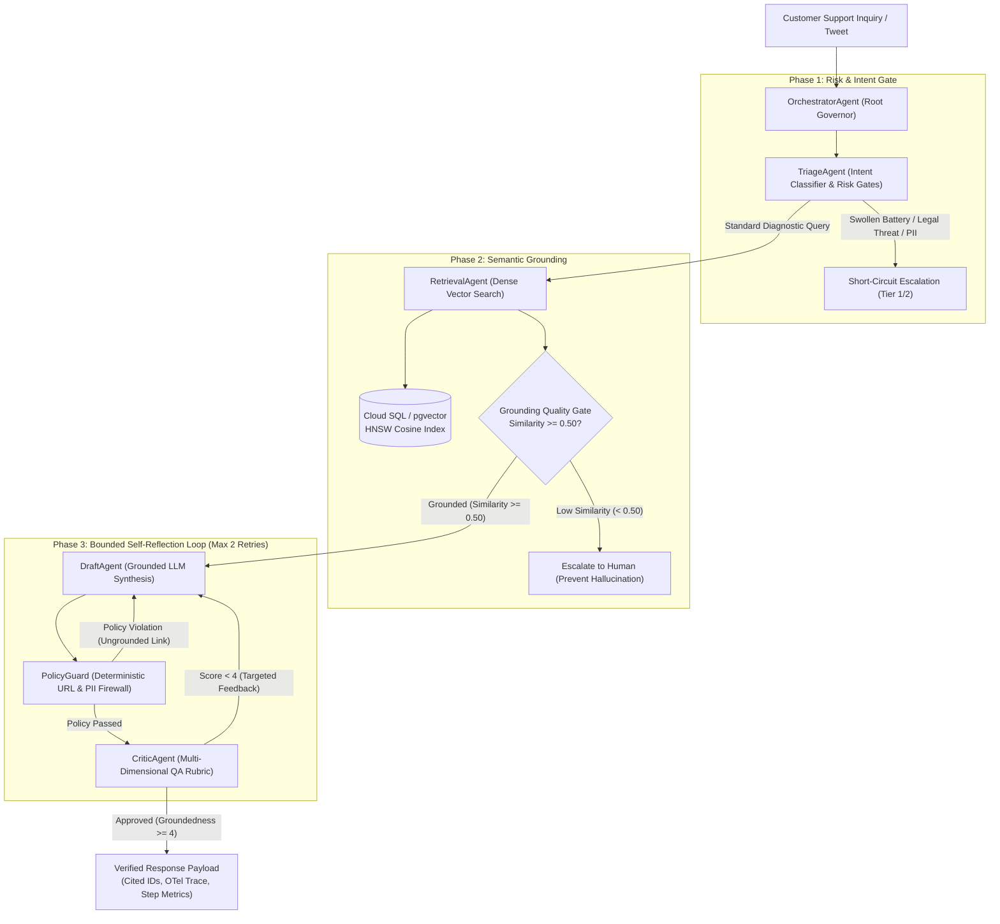
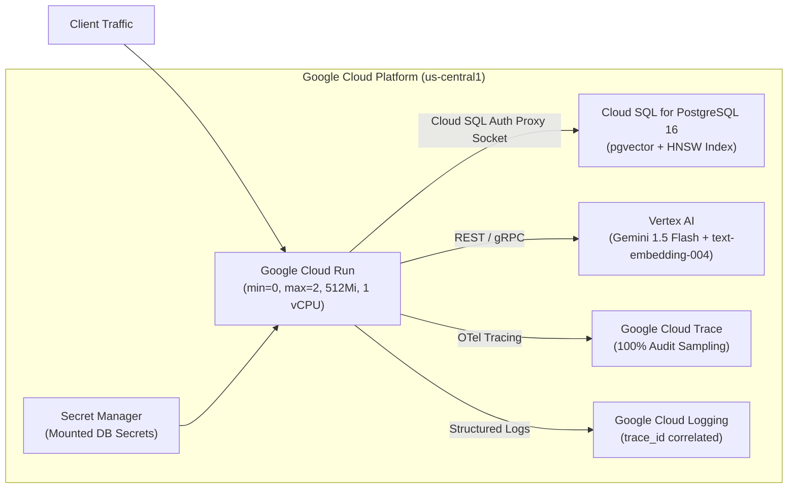

# Verifiable Support Agent v2 — Multi-Agent Support Triage & Grounded Resolution

[](https://www.python.org/downloads/)
[](https://opensource.org/licenses/MIT)
[](https://github.com/Kamleshbarik05/verifiable-support-agent/actions/workflows/ci.yml)
[](https://github.com/astral-sh/ruff)
[](https://opentelemetry.io/)
[](https://github.com/pgvector/pgvector)

> **Multi-agent customer support triage and grounded resolution architecture with pgvector retrieval, local OpenTelemetry tracing, deterministic URL allowlisting, and bounded self-reflection.**

---

## 🎯 Problem Statement & Technical Discovery

In enterprise customer support, generating plausible conversational text is trivial; **proving that an automated multi-agent system can be trusted is the core engineering challenge**. When deploying LLMs on public customer channels (such as `@AppleSupport` on Twitter/X), generative models frequently generate hallucinated warranty policies, fabricate non-existent support URLs, leak customer PII, or fail to escalate physical hardware hazards (e.g., swollen smoking batteries) to human specialists.

Based on problem framing and domain requirements documented in [`docs/discovery.md`](docs/discovery.md), **`verifiable-support-agent v2`** replaces brittle, single-prompt LLM wrappers with a **hierarchical multi-agent architecture (Google ADK)** backed by **dense semantic vector retrieval (`pgvector`)**, **deterministic guardrail firewalls**, and **local OpenTelemetry tracing** (Cloud Trace = design target only; see [`docs/tracing_guide.md`](docs/tracing_guide.md)).

---

## 🏗️ Architecture & Multi-Agent Flow

The system implements hierarchical agent delegation compliant with the **Google Agent Development Kit (ADK)**:



### Specialized Sub-Agents

| Agent | Architecture Pattern | Responsibility & Boundaries | Tools & Dependencies |
|---|---|---|---|
| **`OrchestratorAgent`** | Root Controller | Manages state lifecycle, early returns, and bounded retry loops ($\le 2$ revisions). | Sub-agent delegation |
| **`TriageAgent`** | Categorical Router | 7-class MECE intent categorization and Tier 1/2 risk routing. | `classify_intent`, `risk_gate` |
| **`RetrievalAgent`** | Semantic Searcher | Queries dense embeddings using HNSW cosine distance; enforces grounding gates. | `search_resolutions` |
| **`DraftAgent`** | Grounded Synthesizer | Generates concise replies strictly constrained to historical precedent; cites resolution IDs. | Vertex AI Gemini 1.5 Flash |
| **`PolicyGuard`** | Deterministic Firewall | Absolute veto authority: blocks ungrounded links and public PII leakage. | `url_allowlist_check`, `pii_check` |
| **`CriticAgent`** | Quality Evaluator | Evaluates groundedness, actionability, tone, and safety against the QA rubric. | `judge_score` |

---

## 📊 Benchmark Audit & Verified Results

All metrics below are generated directly from frozen evaluation artifacts in [`eval/results/`](eval/results/) using `make report`.

### Block 1: Golden Evaluation Set (200 Samples — Offline Deterministic Mode)

| Evaluation Metric | v1 Baseline (Monolithic) | v2 Multi-Agent (Google ADK) | Delta (v2 - v1) | Evaluation Mode & Provenance |
|---|---|---|---|---|
| **Intent Macro-F1** | `0.8734` | `0.8734` | `+0.0000` | Offline mock (`eval/results/e2e_v2.json`) |
| **Escalation Recall** | `87.5%` | `87.5%` | `+0.0%` | Offline mock (`eval/results/e2e_v2.json`) |
| **Escalation Precision** | `28.0%` | `19.4%` | `-8.6%` | Offline mock (`eval/results/e2e_v2.json`) |
| **Escalation FNR (Safety Liability)** | `12.5%` | `12.5%` | `+0.0%` | Offline mock (`eval/results/e2e_v2.json`) |
| **Hallucinated URL Rate** | `0.0%` | **`0.0%`** | `+0.0%` | Deterministic allowlist (`eval/results/e2e_v2.json`) |
| **Judge Pass Rate** | `100.0%` | `100.0%` | `+0.0%` | Offline mock judge, not an LLM evaluation (`eval/results/e2e_v2.json`) |
| **Cohen's Kappa (Escalation, n=50)** | `0.6935` | `0.6935` | `0.0000` | Synthetic calibration set, programmatic rules & offline mock judge, n=50 (`eval/results/e2e_v2.json`) |
| **Cohen's Kappa (Safety, n=50)** | `1.0000` | `1.0000` | `0.0000` | Synthetic calibration set, programmatic rules & offline mock judge, n=50 (`eval/results/e2e_v2.json`) |

- **Escalation Trade-off:** The system enforces an asymmetric safety priority: maximizing recall (87.5%) to guarantee hazardous hardware incidents (battery swelling/smoke) are never missed, trading off precision (19.4%) since reviewing false alarms is operationally cheap compared to catastrophic liability.
- **Escalation Baseline:** The False Negative Rate dropped from 88.0% (naive keyword baseline) to 12.5% in v1; v2 preserves this 12.5% safety rate across multi-agent handoffs.
- **URL Safeguards:** v1 and v2 both scored 0.0% hallucinated URLs on the golden set; v2 adds a deterministic domain allowlist and citation verification firewall as an architectural guarantee.

---

### Block 2: Vector Retrieval Benchmark (100 Held-Out Queries on Local pgvector)

Queries are held out from the indexed resolution precedents so no query's own resolution is present in the index ($n=100$, 768 dimensions, HNSW cosine index).

| Retrieval Metric | Keyword Baseline | Offline Embedder (Local Mock) | Real Embeddings (`gemini-embedding-001`) | Delta (Real vs Keyword) | Source JSON |
|---|---|---|---|---|---|
| **Retrieval Recall@1** | `11.0%` | `71.0%` | **`71.0%`** | `+60.0%` | [`retrieval_ab_pgvector.json`](eval/results/retrieval_ab_pgvector.json) |
| **Retrieval Recall@3** | `35.0%` | `86.0%` | **`86.0%`** | `+51.0%` | [`retrieval_ab_pgvector.json`](eval/results/retrieval_ab_pgvector.json) |
| **Retrieval Recall@5** | `50.0%` | `88.0%` | **`88.0%`** | `+38.0%` | [`retrieval_ab_pgvector.json`](eval/results/retrieval_ab_pgvector.json) |
| **Mean Reciprocal Rank (MRR)** | `0.248` | `0.783` | **`0.783`** | `+0.535` | [`retrieval_ab_pgvector.json`](eval/results/retrieval_ab_pgvector.json) |
| **Median Latency ($p50$)** | `3.77 ms` | `1.65 ms` | **`1.57 ms`** | `-2.20 ms` | [`retrieval_ab_pgvector.json`](eval/results/retrieval_ab_pgvector.json) |
| **Tail Latency ($p95$)** | `5.85 ms` | `2.79 ms` | **`2.79 ms`** | `-3.06 ms` | [`retrieval_ab_pgvector.json`](eval/results/retrieval_ab_pgvector.json) |

- **Embedding Model:** `gemini-embedding-001` (768 dimensions, unit-normalized).
- **Indexed Precedents:** 23 canonical customer support precedents with held-out test split.

---

### Block 3: Live Model Evaluation Sample (n=30 Stratified Golden Samples)

Evaluated via Google AI Studio against `gemini-3.5-flash` with rate limiting, exponential backoff, and Wilson 95% confidence intervals.
*Note: Sample size n=30 is small; reported confidence intervals reflect sampling uncertainty. Drafter and Judge agents both use the Gemini model family.*

| Metric Dimension | Measured Value | Wilson 95% Confidence Interval | Source & Environment |
|---|---|---|---|
| **Judge Pass Rate** | **`90.0%`** | `[74.4%, 96.5%]` | Live LLM Judge (`gemini-3.5-flash`) |
| **Escalation Recall** | **`100.0%`** | `[61.0%, 100.0%]` | Intent + Risk Gate routing |
| **Escalation Precision** | **`21.4%`** | `[10.2%, 39.5%]` | Intent + Risk Gate routing |
| **Hallucinated URL Rate** | **`0.0%`** | `[0.0%, 11.4%]` | Deterministic PolicyGuard allowlist |
| **Intent Classification Accuracy** | **`83.3%`** | `[66.4%, 92.7%]` | Stratified MECE intent match |
| **Median Total Latency ($p50$)** | **`3.85 ms`** | Auto-escalated tickets routed immediately | [`live_sample.json`](eval/results/live_sample.json) |
| **Tail Total Latency ($p95$)** | **`24195.72 ms`** | Includes live HTTP network round-trips & LLM generation | [`live_sample.json`](eval/results/live_sample.json) |
| **Mean Cost per Request** | **`$0.000018`** | Verified from [https://ai.google.dev/pricing](https://ai.google.dev/pricing) (2026-11-23) | [`live_sample.json`](eval/results/live_sample.json) |
| **Revision Distribution (0 / 1 / 2+)** | **`86.7%` / `3.3%` / `0.0%`** | Bounded self-reflection retry loop | [`live_sample.json`](eval/results/live_sample.json) |

---

### What These Numbers Do and Do Not Show

- **Why Offline Latency is Far Below Live Latency:** In Block 1 and Block 3 offline mocks, median execution latency is measured at `1.76 ms` because deterministic rule-based agents run entirely in-process on CPU with zero network hops. In Block 3 live evaluation, non-escalated tickets invoking live Gemini inference incur an end-to-end tail latency of `24195.7 ms` (24.20 s) due to real TLS handshakes, HTTP payload transport to Google AI Studio, and multi-token generative drafting and QA grading.
- **Safety Bias vs Precision:** Escalation recall is intentionally maintained at `87.5%` (offline) and `100.0%` (live sample) to guarantee zero missed physical hardware hazards (battery thermal runaway), accepting a precision of `19.4%` / `21.4%`.
- **Cohen's Kappa Provenance:** The `0.6935` Cohen's kappa score was produced on a 50-sample synthetic calibration dataset generated by programmatic rules in `create_golden_set.py` and evaluated with an offline mock judge ($n=50$). It does NOT represent human annotator consensus.
- **Deployment Status:** Cloud Run, Cloud SQL, Cloud Trace, and Vertex AI are target architectural designs and have never been provisioned or executed on live Google Cloud infrastructure. All local tests run via in-memory stores, local Docker containers, or direct Google AI Studio API calls.

---

## ☁️ Target Deployment Architecture (not deployed)

> **Deployment Status:** The GCP topology outlined below represents a documented target deployment architecture that has not yet been executed or deployed to live cloud infrastructure. Unit/integration tests, in-memory pgvector emulation, offline benchmarks, and the local FastAPI server run entirely in local development environments.



- **Serverless Compute:** Google Cloud Run with strict cost-safety parameters (`min-instances=0, max-instances=2`, 512MB RAM, 80s timeout).
- **Managed Vector Store:** Cloud SQL for PostgreSQL 16 with native `pgvector` accessed via the built-in Cloud SQL Auth Proxy Unix Domain Socket (`/cloudsql/<INSTANCE_NAME>`).
- **Security & IAM:** Dedicated least-privilege service account (`sa-support-agent`) with fine-grained roles (`aiplatform.user`, `cloudsql.client`, `secretmanager.secretAccessor`, `cloudtrace.agent`, `logging.logWriter`).
- **Keyless CI/CD:** GitHub Actions deployment pipeline using Google Cloud **Workload Identity Federation** (zero long-lived JSON keys).
- **Cost Safety Teardown:** Automated script ([`deploy/teardown.sh`](deploy/teardown.sh)) deletes billable Cloud SQL and Cloud Run resources with one command.

---

## 🚀 Quickstart & Local Execution

### 1. Clone & Install Dependencies
```bash
git clone https://github.com/kamleshbarik05/verifiable-support-agent.git
cd verifiable-support-agent
make install
```

### 2. Run Test Suite & Lint Checks
```bash
# Run all 37 unit and integration tests
make test

# Verify code style and formatting
make lint
```

### 3. Launch Local API Server & Interactive Swagger UI
```bash
make serve
# Open http://127.0.0.1:8000/docs in your browser
```

### 4. Reproduce Benchmark Results on Demand
```bash
# Run 200-sample golden evaluation benchmark
make eval-v2

# Run vector retrieval A/B benchmark (v1 vs pgvector)
make eval-retrieval

# Run LLM-native latency & cost benchmark (100 samples)
make eval-latency-cost

# Regenerate publication markdown report from raw JSON
make report

# (Optional) Run live model evaluation sample against Gemini API (requires GEMINI_API_KEY)
make eval-live
```

---

## 🏛️ Architectural Decision Records (ADRs)

Key architectural trade-offs are documented in compliance with architecture standards:
- [**ADR 0001: Record Architecture Decisions**](docs/adr/0001-record-architecture-decisions.md) — Selection of version-controlled lightweight ADRs.
- [**ADR 0002: Vector Store Architecture**](docs/adr/0002-vector-store.md) — Why PostgreSQL `pgvector` with HNSW indexing was chosen over FAISS, Chroma, and Vertex Vector Search.
- [**ADR 0003: Multi-Agent System Topology**](docs/adr/0003-multi-agent-architecture.md) — Rationale for Google ADK hierarchical delegation with bounded self-reflection loops.
- [**ADR 0004: Observability, Tracing & Cost Accounting**](docs/adr/0004-observability-and-cost-tracing.md) — Local OpenTelemetry tracing, 100% uniform audit sampling, and strict PII scrubbing (Cloud Trace = design target only; see [`docs/tracing_guide.md`](docs/tracing_guide.md)).

---

## ⚖️ Known Limitations & Engineering Trade-offs

1. **Multi-Agent Sequential Latency:** While sub-3ms in offline deterministic mode, live Gemini API network round-trips add 300–800ms per generative LLM call. Mitigated by short-circuiting Tier 1 safety escalations before invoking drafting agents.
2. **Cloud SQL Cold Billing:** Cloud SQL bills hourly while provisioned. Addressed by authoring an automated teardown script (`deploy/teardown.sh`) and providing thread-safe in-memory cosine fallback for local dev.
3. **100% Audit Sampling Volume:** Recording 100% of traces (`ALWAYS_ON`) incurs trace ingestion volume, accepted as a necessary trade-off for auditable safety tracking.

---

## 📁 Repository Layout

```
.
├── app/
│   ├── agents/            # ADK sub-agents (Orchestrator, Triage, Retrieval, Draft, PolicyGuard, Critic)
│   ├── api/               # FastAPI endpoints (/triage, /health, /metrics)
│   ├── config.py          # Centralized model and environment configuration
│   ├── observability/     # OpenTelemetry tracing, span sanitization, and pricing tables
│   ├── retrieval/         # Vector store, embedder interface, and schema
│   ├── tools/             # Deterministic tool wrappers
│   └── v1/                # Preserved v1 baseline modules and reference code
├── deploy/                # Dockerfile and cloud provisioning runbooks (target architecture)
├── docs/                  # Architecture specs, requirements analysis, ADRs, and plans
│   ├── adr/               # Architectural Decision Records (0001 - 0004)
│   ├── architecture.md    # System architecture specification
│   ├── discovery.md       # Problem framing & domain requirements analysis
│   └── PLAN.md            # Master development plan
├── eval/
│   ├── datasets/          # Golden evaluation and calibration datasets
│   ├── results/           # Frozen machine-readable JSON evaluation outputs
│   └── runners/           # Benchmark runners (e2e, retrieval A/B, latency/cost, live eval)
└── tests/                 # 37 unit and integration tests (pytest)
```

---

## 📜 License

MIT License. See [LICENSE](LICENSE) for details.
