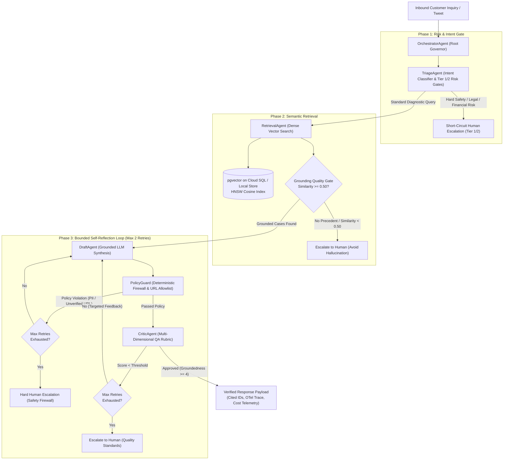
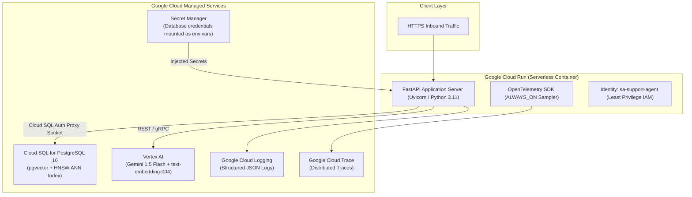

# System Architecture Specification

## Verifiable Support Agent v2 — Multi-Agent Platform Architecture

---

## 1. Executive Overview
The **Verifiable Support Agent v2** is a multi-agent customer support triage and grounded resolution platform. Engineered to address enterprise hallucination, regulatory liability, and cost unpredictability in autonomous customer engagement, the system transforms unstructured customer inquiries (e.g., Apple Support tweets) into verifiable, policy-compliant resolutions.

Designed around **Google Cloud Platform (GCP)** target deployment patterns and implementing the **Google Agent Development Kit (ADK)** hierarchical pattern, the platform replaces brittle prompt-stuffed architectures with specialized agents operating under deterministic quality and safety gates.

---

## 2. Multi-Agent System Topology (Google ADK)



---

## 3. Subsystem Breakdown

### 3.1 Orchestrator & State Contract (`app/agents/orchestrator.py` & `app/agents/state.py`)
- **State Model:** Unified `AgentState` payload passing validated Pydantic models across agent boundaries.
- **Hierarchical Governance:** The Orchestrator manages sub-agent delegation, enforces early returns on safety triggers, and maintains state transitions.
- **Bounded Reflection Loop:** Restricts drafting revisions to `max_revisions = 2`. Infinite loops are mathematically prohibited; failing drafts escalate safely to human agents.

### 3.2 Triage & Risk Tiers (`app/agents/triage_agent.py` & `app/tools/triage_tools.py`)
- **7-Class MECE Intent Taxonomy:** Evaluates customer inquiry against hardware battery, software OS, Apple ID security, billing/refunds, iCloud sync, feature how-to, or out-of-scope rants.
- **Risk Tiers:**
  - `TIER_1_HARD_GUARDRAIL`: Physical battery fires, explosions, legal lawsuits, and public PII leakage (immediate human routing).
  - `TIER_2_POLICY_RISK`: Financial chargebacks and account lockouts requiring human authorization.
  - `TIER_2_QUALITY_GATE`: Ambiguous inquiries with low classification confidence ($< 0.70$).

### 3.3 Semantic Grounding & Vector Store (`app/retrieval/*`)
- **Embedder Interface:** Vertex AI `text-embedding-004` (768-dimensional L2-normalized embeddings) with deterministic local fallback.
- **Vector Database:** PostgreSQL 16 with `pgvector`. Employs Hierarchical Navigable Small World (HNSW) indexing:
  ```sql
  CREATE INDEX idx_resolutions_embedding_hnsw
  ON resolutions USING hnsw (embedding vector_cosine_ops)
  WITH (m = 16, ef_construction = 64);
  ```
- **Grounding Gate:** Enforces a minimum cosine similarity threshold ($\ge 0.50$). Queries lacking verified precedent escalate rather than generating plausible hallucinations.

### 3.4 Deterministic Firewall & Policy Guard (`app/agents/policy_guard.py`)
- **Absolute Veto Authority:** Executes deterministic code independent of LLM temperature.
- **URL Allowlisting:** Scans drafted replies against authorized domains (`support.apple.com`, `apple.com`, `reportaproblem.apple.com`) AND verifies that any cited URL exists within the retrieved historical precedent.
- **PII Filter:** Regex detection and redaction of emails and phone numbers.

### 3.5 Observability & Distributed Tracing (`app/observability/*`)
- **OpenTelemetry Standard:** Vendor-neutral tracing exported to local OpenTelemetry collectors (Jaeger/console) locally, with Google Cloud Trace as target deployment architecture.
- **100% Uniform Trace Sampling (`ALWAYS_ON`):** Every customer inquiry and safety escalation is audited.
- **GCP Trace Correlation:** Logs emit `logging.googleapis.com/trace` matching W3C TraceContext headers.
- **Cost Attribution:** Tracks token consumption and calculates exact USD costs per step via versioned Vertex AI pricing tables.

---

## 4. Target Google Cloud Deployment Topology (not deployed)

> **Deployment Status:** This cloud topology represents a target architectural design and has not yet been executed in a live GCP production environment. Local evaluation, tests, and API serving operate with in-memory stores and local telemetry exporters.



---

## 5. Architectural Decision Records (ADRs)

| ADR | Title | Key Decision |
|---|---|---|
| [ADR 0001](adr/0001-record-architecture-decisions.md) | Record Architecture Decisions | Adopt lightweight, version-controlled ADR format. |
| [ADR 0002](adr/0002-vector-store.md) | Vector Store Architecture | Choose `pgvector` on Cloud SQL with HNSW index over FAISS/Chroma. |
| [ADR 0003](adr/0003-multi-agent-architecture.md) | Google ADK Multi-Agent System | Hierarchical delegation with bounded self-reflection loop over monolithic prompt. |
| [ADR 0004](adr/0004-observability-and-cost-tracing.md) | Observability & Cost Tracing | Vendor-neutral OpenTelemetry with 100% uniform sampling and PII scrubbing. |
